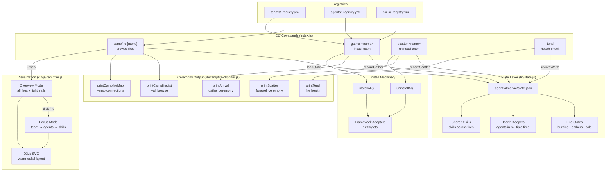
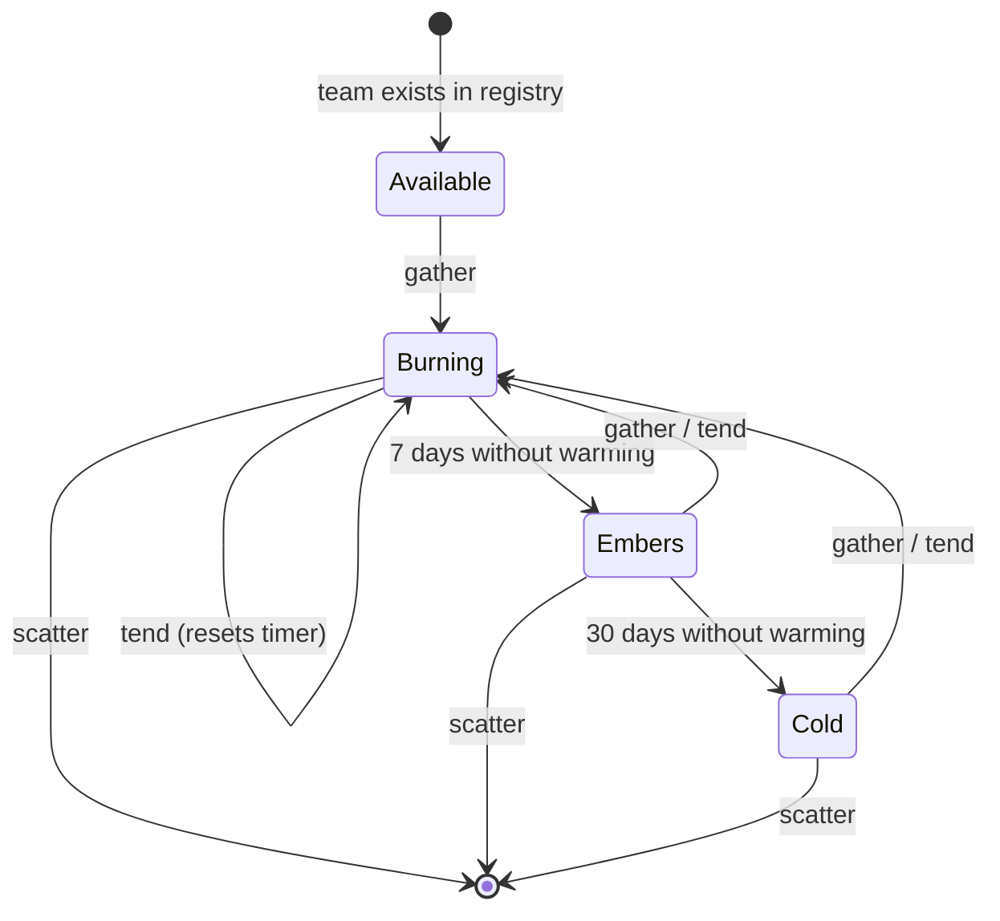

# CLI — Universal Installer

[](https://www.npmjs.com/package/agent-almanac)

Universal skill/agent/team installer for 12+ agentic CLI frameworks. Detects which AI tools are present in a project and installs content into the correct paths using pluggable adapters.

## Supported Frameworks

| Framework | Adapter | Install Path |
|-----------|---------|-------------|
| Claude Code | `claude-code.js` | `.claude/skills/`, `.claude/agents/` |
| Codex (OpenAI) | `codex.js` | `.agents/skills/` |
| Cursor | `cursor.js` | `.cursor/rules/` |
| Copilot | `copilot.js` | `.github/copilot-instructions/` |
| Gemini CLI | `gemini.js` | `.gemini/` |
| Aider | `aider.js` | `.aider/` |
| OpenCode | `opencode.js` | `.opencode/` |
| Windsurf | `windsurf.js` | `.windsurf/` |
| Vibe | `vibe.js` | `.vibe/` |
| Hermes | `hermes.js` | `$HERMES_HOME` / `~/.hermes/` (`%LOCALAPPDATA%\hermes` on Windows) |
| OpenClaw | `openclaw.js` | `.openclaw/` |
| Universal | `universal.js` | `.agents/skills/` |

## Usage

```bash
agent-almanac install <names...>     # Install skills by name
agent-almanac list                   # List available content
agent-almanac search <query>         # Search skills, agents, teams
agent-almanac detect                 # Show detected frameworks
agent-almanac audit                  # Health check installed content
agent-almanac uninstall <names...>   # Remove installed content
```

### Audit exit codes

`audit` always prints its full report before exiting, so a non-zero status never
costs you the reason for it.

| Code | Meaning |
| --- | --- |
| `0` | Audit ran and found no errors |
| `2` | An adapter crashed, so that framework has no verdict at all |
| `3` | Audit ran and found errors |

`1` is deliberately not used for audit findings. It already means "usage or
loader error" — an unknown `--framework`, an undetectable almanac root, or
missing dependencies — so reusing it would leave automation unable to tell *"the
CLI is not installed here"* from *"your install is broken"*.

A crash outranks a finding: a finding is a completed audit that found something,
whereas a crash means that framework produced no verdict at all. Warnings never
affect the exit code, since they describe ordinary states such as `No Copilot
skills installed`.

```bash
agent-almanac audit || echo "audit reported problems (exit $?)"
```

## Install

```bash
npm install -g agent-almanac
```

This registers two commands: `agent-almanac` and `almanac` (shorthand). Verify with:

```bash
agent-almanac --version
```

The version is read from the package manifest, so it always matches the
installed release. (No example output here on purpose — the previous hardcoded
number drifted from both the manifest and the binary. See #456.)

Requires Node.js 22.12 or newer, matching the `engines` field in `package.json`.

### From source

If you prefer to install from source:

```bash
git clone https://github.com/pjt222/agent-almanac.git
cd agent-almanac
npm install
npm link
```

### Try the Campfire

```bash
# Browse all 15 campfires (teams as circles of practice)
agent-almanac campfire --all

# Inspect a specific fire — see its keepers, pattern, and practices
agent-almanac campfire tending

# See which agents bridge multiple fires (hearth-keepers)
agent-almanac campfire --map

# Gather (install) a team — agents arrive, skills settle
agent-almanac gather tending

# Same, but with full skill-by-skill ceremony output
agent-almanac gather r-package-review --ceremonial

# Check fire health (burning / embers / cold)
agent-almanac tend

# Check without warming (read-only, does not update timestamps)
agent-almanac tend --dry-run

# Scatter (uninstall) a team — agents depart, shared skills stay
agent-almanac scatter tending

# Machine-readable output for scripting
agent-almanac campfire --json
```

### State

Campfire state is stored in `.agent-almanac/state.json` in your current working directory. It tracks which fires are gathered, when they were last warmed, and which agents belong to each. This file is already in `.gitignore`.

### Running from Another Project

The CLI looks for the almanac root in this order:

1. the current directory, if it holds `skills/_registry.yml`;
2. `.claude/skills` in the project, and then
3. `~/.claude/skills` in your home directory, each only when its own real path
   lies inside a checkout (for example `.claude/skills -> <clone>/skills`). The
   per-skill links `install` creates (`.claude/skills/<id>`,
   `.agents/skills/<id>`, …) are never followed, nor is a `~/.claude/skills`
   holding one link per skill, or a project link to such a directory;
4. the current directory's parents;
5. last, the package the CLI itself ships in.

The package is used only when nothing earlier is found. So an npm-installed
CLI run outside any checkout reads its own content, and `list`, `search`,
`audit`, `campfire` and `list --installed` need no clone. A project you
installed into from a clone is not recognised as one, though: it resolves to
the package, whose catalogue can differ from the clone's, so keep passing
`--source <clone>` there until detection follows those links (#606). To use a
particular checkout, pass it explicitly:

```bash
agent-almanac campfire --all --source /path/to/agent-almanac
```

### Installing from the npm package

When the root found is the npm package itself (a directory inside
`node_modules`), `install`, `gather` and `sync` refuse by default, dry runs
included. npm says nothing about links it did not make: `npm uninstall`
removes that directory and every link into it dangles; `npm update` replaces
it, so the links either follow the new version silently (except that a link
to an item it removed dangles) or, in a version-keyed layout (npm
`install-strategy=linked`, measured; pnpm, by inference), break. There are
three ways forward:

```bash
# From a clone: the links point at a directory you control. Pass --source on
# every later install from the project too: detection does not follow the
# links install makes, so without it the CLI finds the npm package again.
git clone https://github.com/pjt222/agent-almanac.git ~/agent-almanac
agent-almanac install commit-changes --source ~/agent-almanac

# Or copy out of the npm package (a NOTE on stderr): the copies outlast npm update and npm uninstall
agent-almanac install commit-changes --from-package copy
agent-almanac audit    # warns, exit 0, when a copy's version differs from this CLI's or a copy was edited

# Or link into the npm package anyway (it warns, on stderr), and audit after every npm update
agent-almanac install commit-changes --from-package link
agent-almanac audit    # exits 3 on links that broke; it cannot tell that an update changed their content
```

**Copies.** A copied directory holds a marker, `.agent-almanac-copy.json`; a
copied agent file has a hidden sidecar beside it,
`.<name>.agent-almanac-copy.json`. The marker records the package's name and
version (from its `package.json`), the item, its path in the package, when it
was copied and a sha256 of every file, and no absolute path, so a project can
commit its copies. `list --installed` shows a copy as
`commit-changes skill (copy, agent-almanac 1.9.1)`.

- `uninstall`, `scatter` and `sync` remove a copy only while its marker names it
  and every recorded file is unchanged, with nothing added. An edited copy is
  kept, and the changed files are named; delete it by hand to remove it. Not
  edits: a file whose only change is LF turned into CRLF, and files an OS or
  editor drops that were not copied (`.DS_Store`, `Thumbs.db`, `desktop.ini`,
  vim swap files, emacs auto-save and lock files, and `.pyc` or `.pyo` files
  under `__pycache__`).
- `install --force --from-package copy` replaces a link or an unedited copy,
  never an edited copy. No command removes a file or directory the CLI did
  not make, with two exceptions: the OS and editor files listed above, which
  go with the copy they are in; and a change saved to a copy while
  `uninstall`, `scatter`, `sync` or `install --force` is checking it, which
  can be removed or replaced with the copy, because the check and the removal
  are not one atomic step.
  Without `--force`, `install` and `gather` keep what is there and say what it
  is: `gather` on stderr, so `--json` stays one document.
- `audit` lists copies by version and warns, exit 0, when a copy's version
  differs from the running CLI's, when a copy was edited, and when a marker
  cannot be read. Run it, and `uninstall`, with the install's scope and
  frameworks, as for links.
- From a root that is not an npm package, `--from-package copy` is refused and
  `--from-package link` says on stderr that it has no effect.
- Measured on Linux (WSL), Node 22, 24 and 26. Windows is unmeasured.

A root counts as an npm package when a `node_modules` path segment appears in
it, as given or as its real path. Two limits follow. The match is
case-sensitive, so on a case-insensitive filesystem a path typed with
`Node_Modules` is not caught. And a clone that happens to live under a
directory named `node_modules` is refused too, with `--from-package link` as
its only way through.

## Campfire Architecture

The campfire layer wraps the install/uninstall machinery in a team-oriented metaphor: teams are "fires", agents are "keepers", skills are "practices". It spans CLI commands, persistent state, ceremony output, and a D3 visualization mode.



### Fire Lifecycle



### Vocabulary Mapping

| Campfire Term | System Concept |
|---------------|---------------|
| Fire / Campfire | Team (installed) |
| Fire Keeper | Team lead agent |
| Keeper | Agent (team member) |
| Practice / Spark | Skill |
| Hearth Keeper | Agent shared across fires |
| Gather | Install team + agents + skills |
| Scatter | Uninstall (respecting shared deps) |
| Tend | Health check + warm timestamp |
| Burning / Embers / Cold | Recency of last use |

## Architecture

```
cli/
  index.js             # CLI entry point (commander.js)
  lib/
    registry.js        # Registry loading and skill resolution
    resolver.js        # Almanac root and target directory resolution
    detector.js        # Framework auto-detection
    installer.js       # Install/uninstall/audit orchestrator
    manifest.js        # Installed content manifest management
    reporter.js        # Console output formatting
    campfire-reporter.js # Warm ceremony output
    state.js           # .agent-almanac/state.json management
    transformer.js     # Content transformation for target frameworks
  adapters/
    base.js            # Base adapter class
    claude-code.js     # Claude Code adapter (full support)
    codex.js           # Codex adapter
    cursor.js          # Cursor adapter
    ...                # 12 framework adapters total
  test/
    cli.test.js        # CLI integration tests
```

## See Also

- [Root README](../README.md) -- project overview
- [Symlink Architecture](../guides/symlink-architecture.md) -- how discovery works across tools
- [skills/README.md](../skills/README.md#consuming-skills-from-different-systems) -- per-tool integration details
